<div align="center">

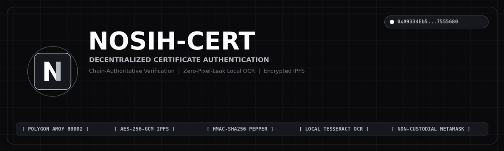

<br/>

[](./deployments/amoy.json)
[](./contracts/CertificateRegistry.sol)
[](./backend/services/ipfs.js)
[](./backend/services/ocr.js)
[](./backend/supabase/schema.sql)
[](./package.json)

<h3>Chain-Authoritative Credential Verification &nbsp;·&nbsp; Zero PII On-Chain &nbsp;·&nbsp; Non-Custodial MetaMask Issuance</h3>

<p>
  <a href="#-live-interface-walkthrough"><b>Live UI Walkthrough</b></a> &nbsp;·&nbsp;
  <a href="#-architecture--three-stores-three-jobs"><b>Architecture</b></a> &nbsp;·&nbsp;
  <a href="#-core-workflows"><b>Animated Workflows</b></a> &nbsp;·&nbsp;
  <a href="#-interface-gallery"><b>Screenshots</b></a> &nbsp;·&nbsp;
  <a href="#-technology-stack"><b>Tech Stack</b></a> &nbsp;·&nbsp;
  <a href="#-quick-start"><b>Quick Start</b></a>
</p>

</div>

---

## ▸ Live Interface Walkthrough

<div align="center">
  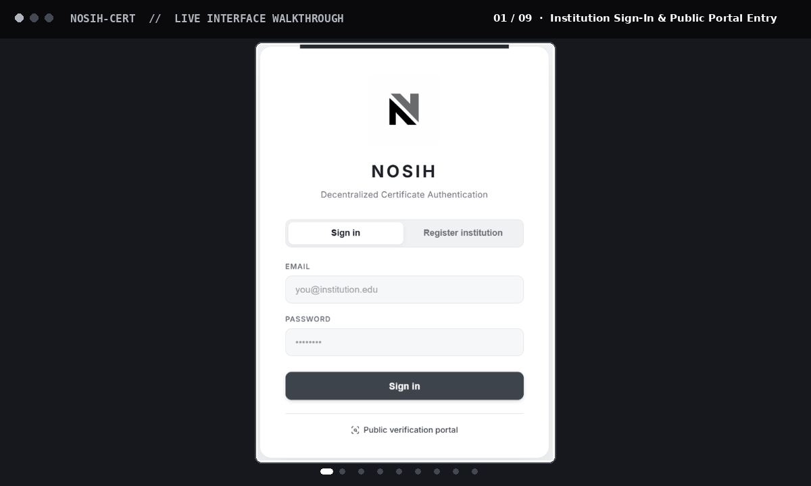
  <br/>
  <sub><i>End-to-end walkthrough: Sign-In → Platform Dashboard → PDF Upload → Local OCR → Institutions & Wallets → Public Verification → QR & On-Chain Proof</i></sub>
</div>

---

## ▸ Architecture — Three Stores, Three Jobs

> **The blockchain is the sole authority.** A certificate is authentic only when its on-chain record on **Polygon Amoy (`0xA9334Eb5E1c2811dcAE32880702092a7A7555680`)** matches the approved document hash and canonical metadata hash, and its issuer wallet is bound to an approved institution.

<div align="center">
  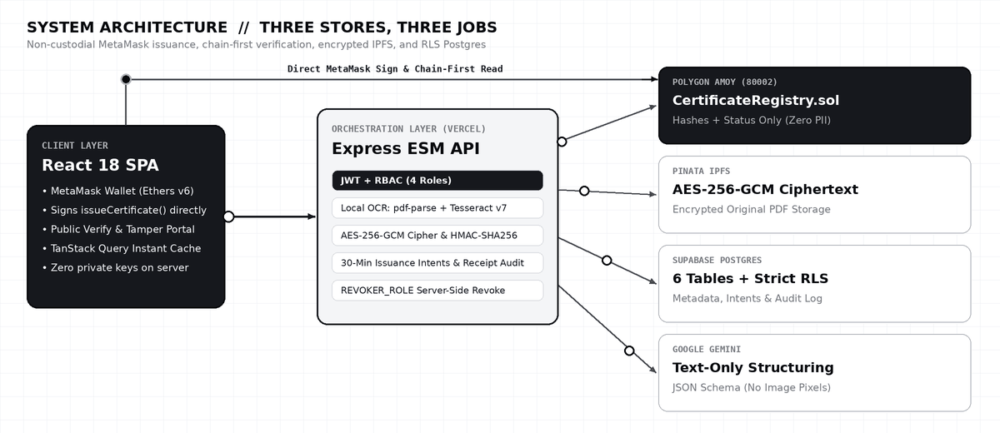
</div>

| Store / Layer | Implementation | Responsibility | Privacy & Security Guarantee |
| :--- | :--- | :--- | :--- |
| **Blockchain** | Polygon Amoy (`80002`) · `CertificateRegistry.sol` | Keyed hashes, issuer binding & lifecycle status | **Zero PII on-chain** — only `keccak256`, `SHA-256`, and `HMAC-SHA256` digests |
| **Encrypted Storage** | Pinata IPFS · `AES-256-GCM` | Original certificate PDF archival | **Ciphertext-only pinning** — encrypted with `DOCUMENT_ENC_KEY` before upload |
| **Relational Index** | Supabase Postgres · 6 tables + strict RLS | Institutions, staff, intents, metadata & private audit log | **Zero public RLS policies** — accessible exclusively via backend service-role key |
| **AI & Local OCR** | `pdf-parse` + `Tesseract.js v7` + Google Gemini | Field extraction from digital & scanned PDFs | **Pixels never leave server** — plain text only sent to Gemini; human approval mandatory |

---

## ▸ Core Workflows

### 1. Certificate Issuance & Non-Custodial MetaMask Handshake

<div align="center">
  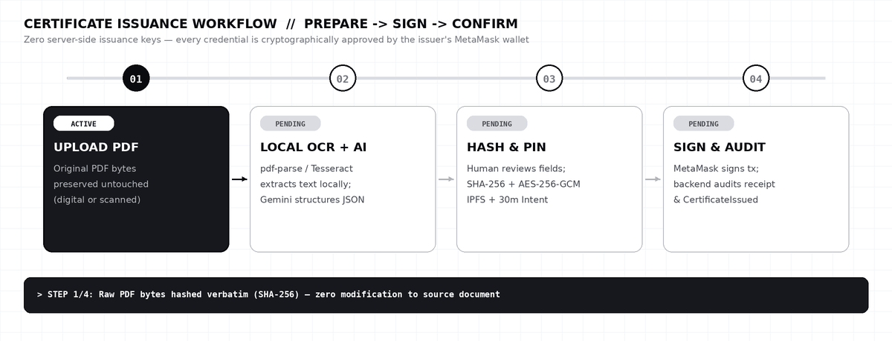
</div>

- **Prepare**: Backend hashes exact uploaded PDF bytes (`SHA-256`) and human-approved canonical metadata, encrypts (`AES-256-GCM`) and pins the PDF to Pinata IPFS, and creates a **30-minute `issuance_intents`** lock.
- **Sign**: The issuer's **MetaMask wallet** signs `issueCertificate()` directly on Polygon Amoy — there is **no `ISSUER_PRIVATE_KEY`** anywhere on the server.
- **Confirm**: Backend independently verifies the transaction receipt and every `CertificateIssued` event field against the intent (idempotent, retry-safe `202` while pending) before marking the certificate authoritative.

---

### 2. Zero-Pixel-Leak Local OCR & Structured Extraction

<div align="center">
  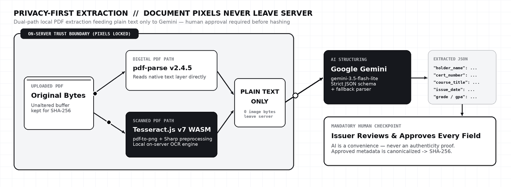
</div>

- **Digital PDFs** extract text directly from the native layer via `pdf-parse v2.4.5`.
- **Scanned PDFs** render locally via `pdf-to-png-converter` + `Sharp` and run on-server WASM OCR via `Tesseract.js v7`.
- **Text-Only AI**: Only extracted plain text crosses to Google Gemini (`gemini-3.5-flash-lite` with fallback chain) for JSON structuring — **never raw PDFs or image bytes**. Every field requires explicit human confirmation before hashing.

---

### 3. Chain-First Public Verification & Dual Tamper Checks

<div align="center">
  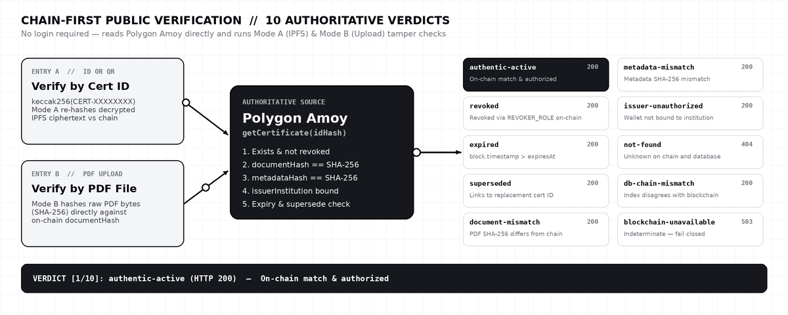
</div>

- **No Account Required**: Anyone verifies via **Certificate ID / QR Code** (`/verify/certificate-id`) or **PDF Upload** (`/verify/upload`).
- **Dual Tamper Engine**: **Mode A** decrypts and re-hashes the IPFS ciphertext against the chain; **Mode B** hashes uploaded PDF bytes directly against on-chain `documentHash`.
- **Fail-Closed Chain Reads**: If the RPC/chain cannot be reached, NOSIH returns `blockchain-unavailable` (`HTTP 503` indeterminate) — never trusting the database alone.

---

### 4. Institution Governance, Wallet Binding & Revocation / Reissue

<div align="center">
  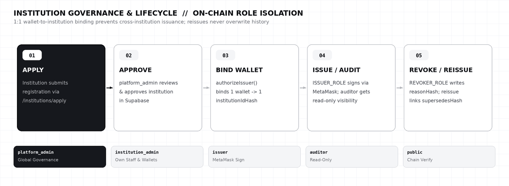
</div>

- **1:1 Wallet Binding**: `authorizeIssuer(wallet, institutionIdHash)` binds one wallet strictly to one institution, preventing cross-institution issuance.
- **Isolated Revocation**: Revocation is the **only server-side chain write**, executed by a dedicated `REVOKE_PRIVATE_KEY` (`REVOKER_ROLE`). Human-readable reasons stay private in `certificate_events`; only their peppered `HMAC-SHA256` hash goes on-chain.
- **Non-Destructive Reissue**: Corrections never overwrite history — reissuing mints a new certificate ID with `supersedesCertificateIdHash` linking back to the original.

---

## ▸ Interface Gallery

<table>
  <tr>
    <td width="50%" align="center">
      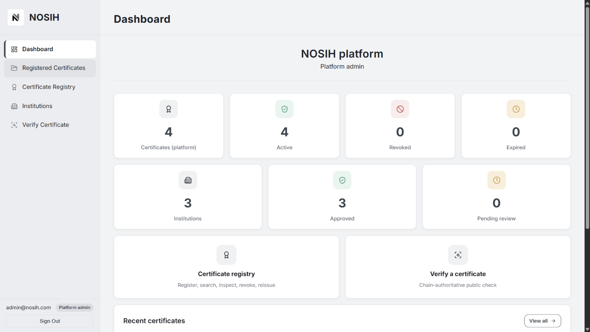
      <br/><sub><b>Platform Admin Dashboard</b> — Live certificate & institution metrics</sub>
    </td>
    <td width="50%" align="center">
      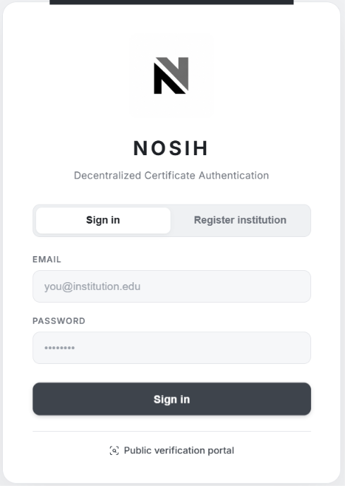
      <br/><sub><b>Authentication & Onboarding</b> — Sign in, apply, or jump to Public Verify</sub>
    </td>
  </tr>
  <tr>
    <td width="50%" align="center">
      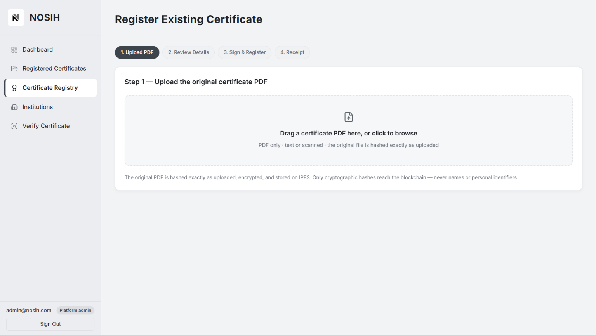
      <br/><sub><b>Issuance Step 1</b> — Drag & drop original PDF (hashed verbatim)</sub>
    </td>
    <td width="50%" align="center">
      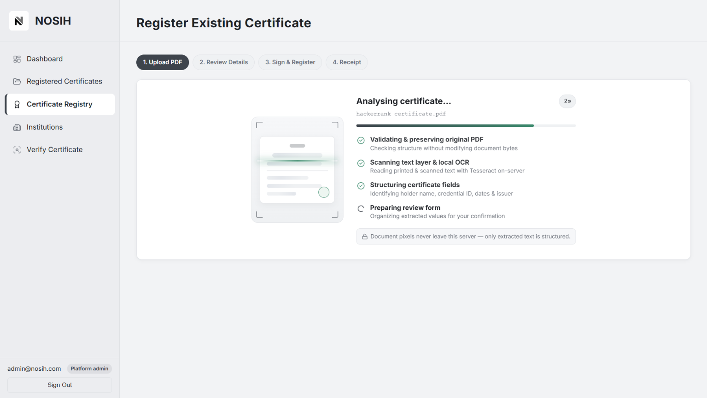
      <br/><sub><b>On-Server OCR Analysis</b> — Live Tesseract.js v7 & text structuring progress</sub>
    </td>
  </tr>
  <tr>
    <td width="50%" align="center">
      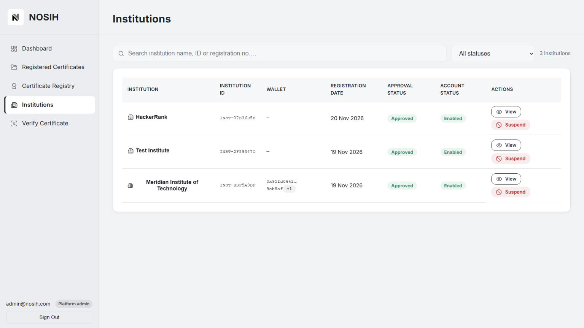
      <br/><sub><b>Institutions Directory</b> — Search, filter, approve, or suspend issuers</sub>
    </td>
    <td width="50%" align="center">
      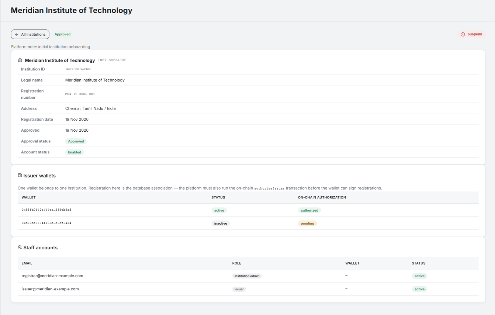
      <br/><sub><b>Institution Governance</b> — 1:1 issuer wallets, on-chain status & staff accounts</sub>
    </td>
  </tr>
  <tr>
    <td width="50%" align="center">
      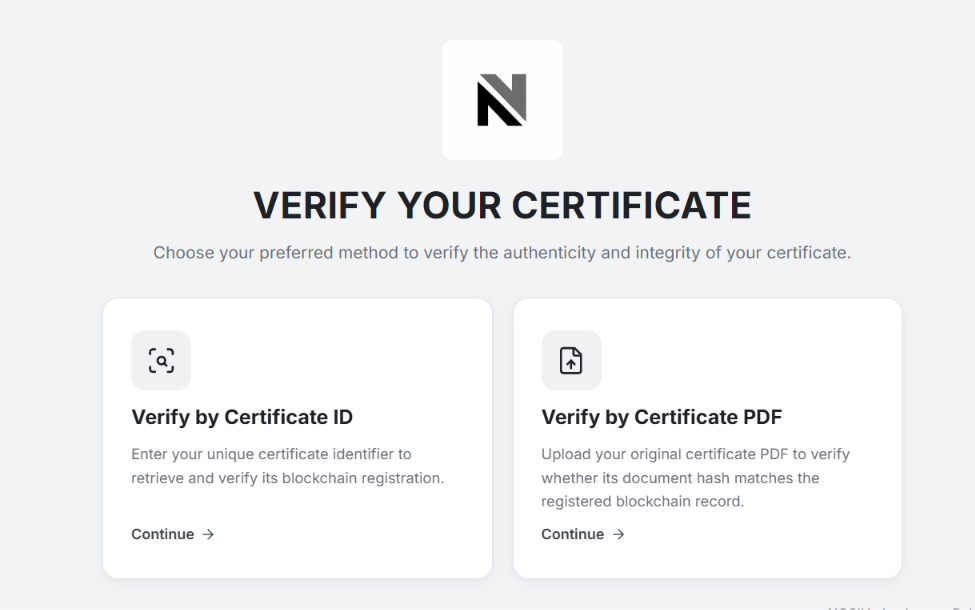
      <br/><sub><b>Public Verification Portal</b> — Verify by Certificate ID or PDF upload</sub>
    </td>
    <td width="50%" align="center">
      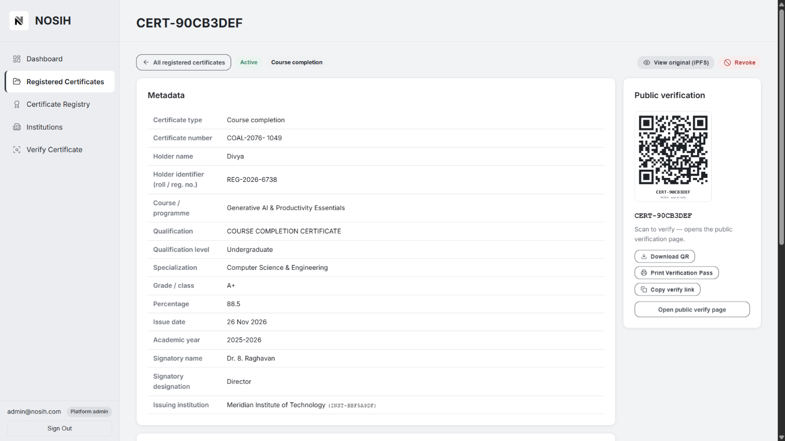
      <br/><sub><b>Registered Certificate & QR</b> — Metadata, downloadable QR & verification pass</sub>
    </td>
  </tr>
  <tr>
    <td colspan="2" align="center">
      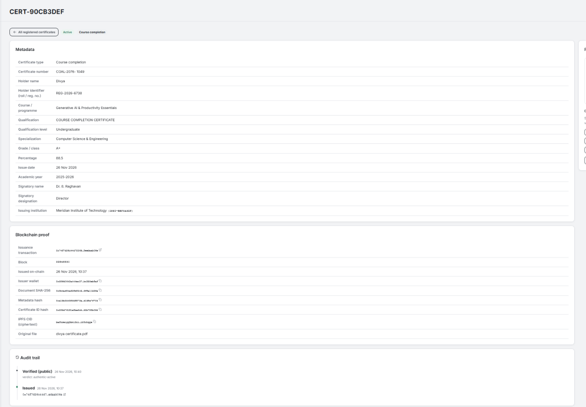
      <br/><sub><b>Cryptographic Proof & Audit Trail</b> — Transaction hash, block number, SHA-256 hashes, IPFS ciphertext CID & verification events</sub>
    </td>
  </tr>
</table>

---

## ▸ Technology Stack

| Layer | Technologies & Versions |
| :--- | :--- |
| **Smart Contracts** | Solidity `0.8.20` · OpenZeppelin Contracts `^5.0.0` (`AccessControl`, `ReentrancyGuard`) · Hardhat `^2.19.0` · Polygon Amoy (`80002`) |
| **Frontend SPA** | React `18.2.0` · React Router `6.20.1` · TanStack Query `5.8.4` · Ethers `6.8.1` · Lucide React `1.60.0` · `qrcode.react` · `react-dropzone` |
| **Backend API** | Node `22.x` · Express `4.18.2` (ESM) · Ethers `6.8.1` · Supabase JS `2.118.0` · Joi `18.0.2` · JWT · `bcryptjs` · `express-rate-limit` · Multer |
| **OCR & AI Pipeline** | `pdf-parse 2.4.5` · `pdfjs-dist 5.4.296` · `pdf-to-png-converter 3.11.0` · `Sharp 0.35.2` · `Tesseract.js 7.0.0` (WASM) · `@google/generative-ai 0.24.1` |
| **Storage & Hosting** | Supabase Postgres (6 tables + RLS) · Pinata IPFS (`AES-256-GCM`) · Vercel (`vercel.json`, same-origin `/api/*` rewrite) |

### Role-Based Access Matrix

| Role | Capabilities |
| :--- | :--- |
| `platform_admin` | Approve/reject/suspend institutions, manage any institution's staff & wallets, revoke any certificate |
| `institution_admin` | Manage own institution profile, wallets & staff; issue, revoke & reissue own certificates |
| `issuer` | Issue and reissue own institution's certificates via MetaMask |
| `auditor` | Read-only visibility into own institution's certificates and audit trails |
| `public` | Verify by Certificate ID / QR code and run Mode A / Mode B tamper checks — no account |

---

## ▸ Quick Start

<details open>
<summary><b>1. Local Setup & Run</b></summary>

```bash
# Install dependencies across contract tooling, backend, and frontend
npm install
npm install --prefix backend
npm install --prefix frontend

# Configure environment variables (see .env.example for all keys)
cp .env.example .env
```

1. **Database**: Run `backend/supabase/schema.sql` (fresh project) or `backend/supabase/migrations/001_nosih.sql` (additive migration) in Supabase SQL Editor.
2. **Seed Admin**: `npm run seed:admin`
3. **Deploy Contract**: `npm run deploy:amoy -- --yes` (writes `deployments/amoy.json` and updates ABIs + `CONTRACT_ADDRESS`).
4. **Authorize Issuer Wallet**: Approve institution in the portal, then run `npm run issuer:add -- --yes`.
5. **Start Services**:
   ```bash
   npm --prefix backend run dev   # Express API (port 5000 / 5001)
   npm --prefix frontend start    # React SPA (port 3000, proxies /api)
   ```

</details>

<details>
<summary><b>2. Vercel Deployment & Local Verification Gates</b></summary>

```bash
vercel login
npm run vercel:env      # Push backend + build-time REACT_APP_* variables
npm run check:deploy    # Preflight: env, credentials, native modules & trace
npm run vercel:deploy
```

| Gate Command | Scope |
| :--- | :--- |
| `npm test` | Hardhat in-memory contract, issuance handshake & verification suites |
| `npm run check:p2` … `check:p8` | Offline schema/authz, extraction, storage/QR, handshake, verify & UI contracts |
| `npm run check:ui-render` | Production bundle jsdom render verification |
| `npm run check:env` / `check:gas` | Env audit, wallet derivation, RPC & gas balances (read-only) |
| `npm run check:services` / `check:ipfs` | Live read-only Supabase, Gemini & Pinata roundtrip diagnostics |
| `npm run check:extract` | Real Gemini text-only extraction on digital + scanned fixtures |
| `npm run smoke:api` | Live HTTP authorization & end-to-end API smoke suite |

</details>

<details>
<summary><b>3. Repository Layout & Environment Reference</b></summary>

```text
backend/            Express API (ESM) — routes, services, middleware, Supabase schema
contracts/          CertificateRegistry.sol (Solidity 0.8.20 + OpenZeppelin AccessControl)
deployments/        amoy.json — live Polygon Amoy deployment metadata
frontend/           React 18 SPA — issuance, verification, tamper check & governance UI
scripts/            Deploy/issuer tooling, env + service diagnostics & Vercel automation
test/               Hardhat in-memory test suites
assets/             Monochrome animated workflow GIFs & interface screenshots
```

**Required at boot**: `SUPABASE_URL`, `SUPABASE_SERVICE_ROLE_KEY`, `JWT_SECRET`, `DOCUMENT_ENC_KEY`, `HASH_PEPPER`.  
**Chain & features**: `CONTRACT_ADDRESS`, `GEMINI_API_KEY`, Pinata credentials, `REVOKE_PRIVATE_KEY` (only server-side chain key — back up `DOCUMENT_ENC_KEY` and `HASH_PEPPER`).

</details>
